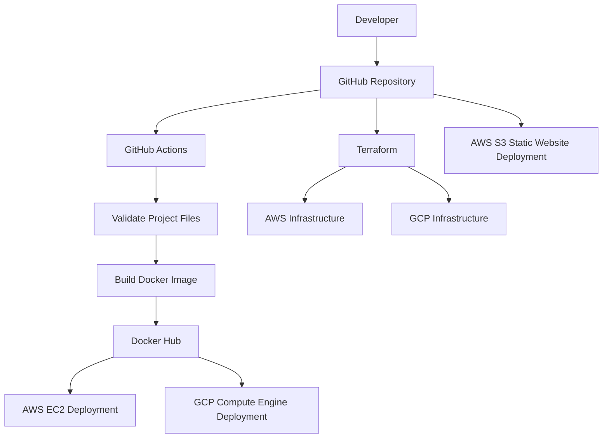
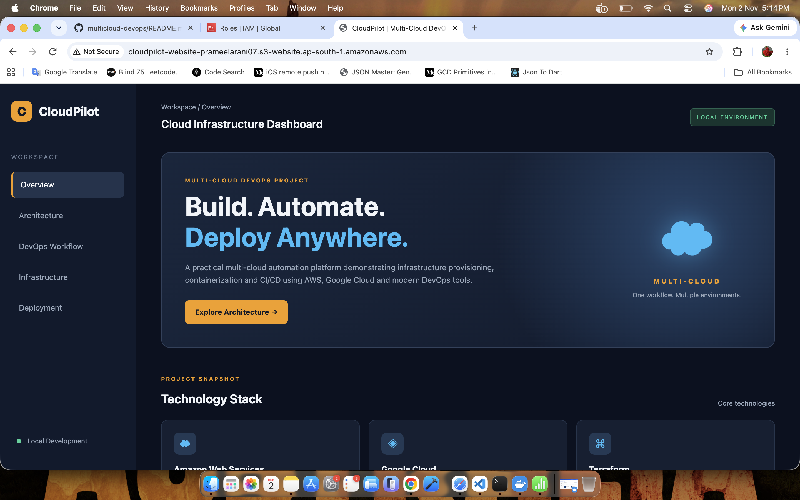
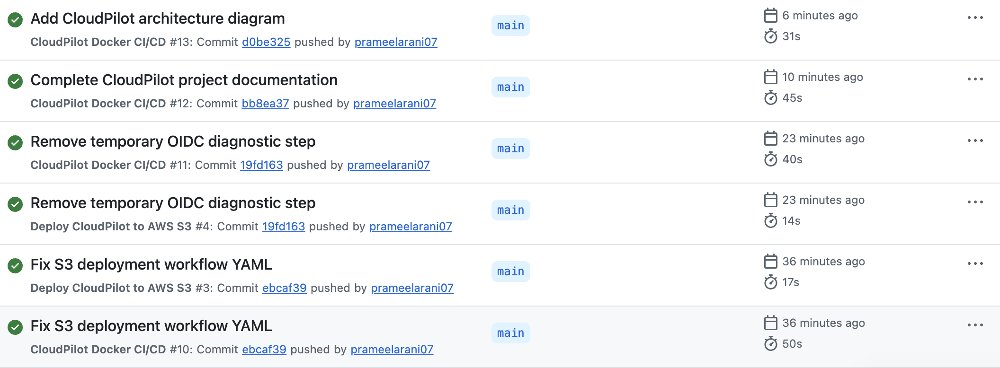
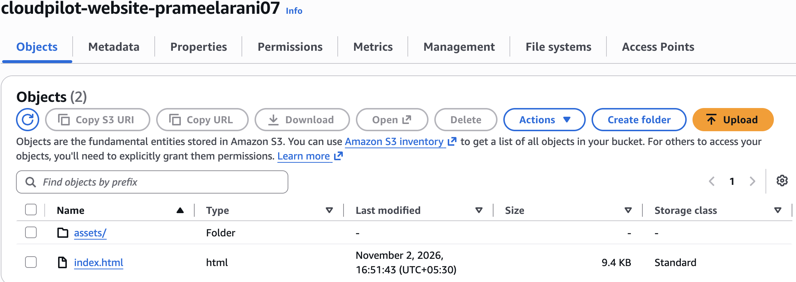
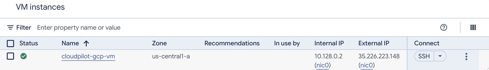

# CloudPilot – Multi-Cloud DevOps Automation Platform

CloudPilot is a hands-on DevOps portfolio project that combines Docker containerization, GitHub Actions CI/CD, and Terraform-based multi-cloud infrastructure automation using Amazon Web Services (AWS) and Google Cloud Platform (GCP).

The project demonstrates how to build, containerize, publish, deploy, and manage a static web application using modern DevOps tools and practices.

> **Project status:** Application development, Docker CI/CD, AWS deployment, GCP deployment, and AWS S3 static website deployment were completed and tested. Cloud infrastructure was subsequently deleted to avoid ongoing charges. Source code, Terraform configurations, workflows, and screenshots are retained for demonstration.

---

## 1. Project Objectives

- Build a responsive static website using HTML, CSS, and JavaScript.
- Containerize the application using Docker and NGINX.
- Automate Docker image builds and publishing using GitHub Actions.
- Publish Docker images to Docker Hub.
- Provision AWS and GCP infrastructure using Terraform.
- Deploy and validate the application in both cloud environments.
- Deploy the static website using AWS S3.
- Practice Infrastructure as Code and CI/CD concepts.

---

## 2. Technology Stack

| Technology | Purpose |
|---|---|
| HTML, CSS, JavaScript | Frontend development |
| Docker | Application containerization |
| NGINX | Web server |
| Docker Hub | Container image registry |
| Git and GitHub | Version control and source code hosting |
| GitHub Actions | CI/CD automation |
| Terraform | Infrastructure as Code |
| AWS EC2 | Cloud application hosting |
| AWS S3 | Static website hosting |
| Google Cloud Compute Engine | Cloud application hosting |
| Visual Studio Code | Code editing |
| Terminal | Development and infrastructure commands |

---

## 3. Project Architecture

The project follows this workflow:

1. Application source code is maintained in GitHub.
2. GitHub Actions runs when code is pushed to the `main` branch or a pull request is created.
3. The workflow checks required project files and builds the Docker image.
4. On pushes to `main`, the image is published to Docker Hub.
5. Terraform configurations provision infrastructure in AWS and GCP.
6. The Docker application is deployed and tested in the cloud environments.
7. AWS S3 is configured for static website hosting and deployment.

### Architecture Diagram



*The diagram represents the project workflow and the infrastructure used during testing. The cloud resources are currently deleted.*

---

## 4. Docker Implementation

The application is packaged using Docker and served through NGINX.

### Build Docker Image

```bash
docker build -t cloudpilot:1.0 .
```

### Run Container

```bash
docker run -d -p 8080:80 --name cloudpilot-container cloudpilot:1.0
```

### Access Application

```text
http://localhost:8080
```

### Stop and Remove Container

```bash
docker stop cloudpilot-container
docker rm cloudpilot-container
```

---

## 5. CI/CD Pipeline – GitHub Actions

The Docker CI/CD pipeline is configured in:

```text
.github/workflows/docker-publish.yml
```

### Pipeline Workflow

- Checkout source code.
- Verify required application files.
- Set up QEMU and Docker Buildx.
- Build the Docker image.
- Authenticate with Docker Hub.
- Publish multi-platform images.

### Docker Hub Repository

[prameelarani0712/cloudpilot](https://hub.docker.com/r/prameelarani0712/cloudpilot)

Published image tags:

```text
prameelarani0712/cloudpilot:latest
prameelarani0712/cloudpilot:1.0
```

Supported platforms:

- linux/amd64
- linux/arm64

The workflow publishes images when changes are pushed to the `main` branch. Pull requests build the image without publishing it.

---

## 6. Multi-Cloud Infrastructure Using Terraform

Separate Terraform configurations were created for AWS and GCP.

### AWS Infrastructure

Location:

```text
terraform/aws/
```

Resources provisioned and tested:

- Amazon EC2 instance
- Security group
- Docker-based application deployment

### GCP Infrastructure

Location:

```text
terraform/gcp/
```

Resources provisioned and tested:

- Google Compute Engine virtual machine
- HTTP firewall rule
- Docker-based application deployment

### AWS S3 Static Website Hosting

Location:

```text
terraform/aws-s3/
```

Resources configured and tested:

- S3 bucket
- Static website hosting configuration
- Website files
- Bucket policy
- Public access configuration

### Terraform Commands

Initialize Terraform:

```bash
terraform init
```

Validate configuration:

```bash
terraform validate
```

Preview infrastructure changes:

```bash
terraform plan
```

Apply infrastructure:

```bash
terraform apply
```

Destroy infrastructure:

```bash
terraform destroy
```

**Note:** The cloud resources have already been destroyed. These commands are included for documentation; running `terraform apply` again would create new cloud resources and may incur charges.

---

## 7. Project Screenshots

### CloudPilot Dashboard



### Docker CI/CD Pipeline



### AWS S3 Deployment



### GCP Infrastructure



These screenshots document the application, pipeline, and cloud deployment work completed during the project.

---

## 8. Project Structure

```text
multicloud-devops/
│
├── .github/
│   └── workflows/
│       ├── docker-publish.yml
│       └── deploy-s3.yml
│
├── assets/
│   ├── css/
│   │   └── style.css
│   ├── js/
│   │   └── script.js
│   └── images/
│
├── screenshots/
│   ├── 01-cloudpilot-dashboard.png
│   ├── 02-docker-cicd-pipeline.png
│   ├── 03-aws-s3-deployment.png
│   └── 04-gcp-infrastructure.png
│
├── terraform/
│   ├── aws/
│   ├── aws-s3/
│   └── gcp/
│
├── Dockerfile
├── index.html
├── README.md
└── .gitignore
```

---

## 9. Project Status

| Component | Status |
|---|---|
| Static website development | Completed |
| Docker containerization | Completed |
| Docker Hub image publishing | Completed |
| GitHub Actions CI/CD | Tested |
| AWS Terraform infrastructure | Deployed, tested and cleaned up |
| GCP Terraform infrastructure | Deployed, tested and cleaned up |
| AWS S3 static website | Deployed, tested and cleaned up |
| Documentation and screenshots | Completed |

### Cloud Resource Cleanup

After successful deployment and validation, the CloudPilot cloud resources were deleted to avoid ongoing charges.

- AWS EC2 instance and associated infrastructure: deleted.
- AWS S3 website bucket and its managed resources: deleted.
- GCP Compute Engine VM, boot disk and CloudPilot firewall rule: deleted.

The default cloud networks and unrelated account resources were not deleted.

The GitHub repository, Docker Hub images, Terraform configuration files, and project screenshots remain available.

---

## 10. Conclusion

CloudPilot provided practical experience in Docker containerization, GitHub Actions CI/CD automation, Terraform-based Infrastructure as Code, and multi-cloud deployment using AWS and GCP.

The project demonstrates the complete workflow from application development and container image publishing to cloud infrastructure provisioning and deployment validation.

It strengthened practical understanding of DevOps tools and cloud deployment workflows while maintaining cost awareness through infrastructure cleanup after testing.

---

**GitHub Repository:** [prameelarani07/multicloud-devops](https://github.com/prameelarani07/multicloud-devops)

**Docker Hub:** [prameelarani0712/cloudpilot](https://hub.docker.com/r/prameelarani0712/cloudpilot)
